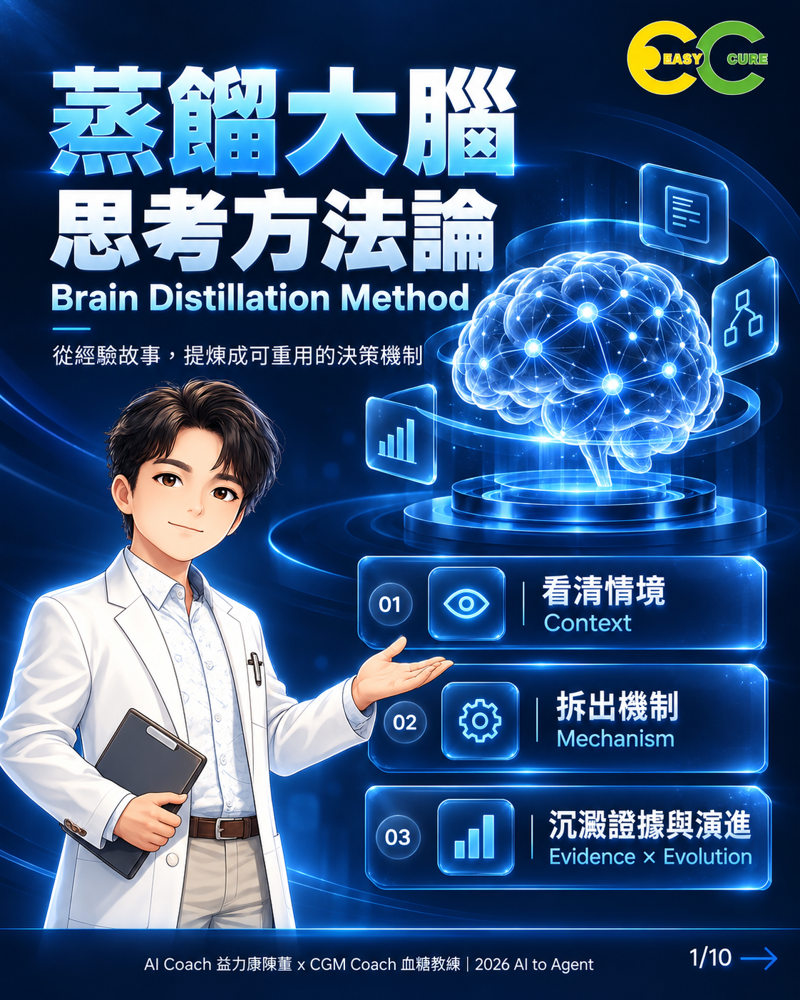

# 蒸餾大腦思考方法論｜Brain Distillation Method

從經驗故事，提煉成可重用的決策機制。

**Repository：** `ai-to-agent-brain-distillation-method`  
**版本：** 0.1.0｜2026-10-02｜方法論與教學教材首版  
**狀態：** 保留所有權利（All rights reserved）。

## 為什麼需要這套方法？

高手常能做出判斷，卻不容易說明看到了什麼、為何優先處理某件事，以及換一種情境是否仍然適用。本專案協助主管、教師、顧問與知識工作者，把經驗拆成可說明、可傳遞、可檢查的方法。

## 核心架構

| 機制 | 核心問題 |
|---|---|
| M1 主導限制配適 | 真正卡住結果的是什麼？方法是否對應這個限制？ |
| M2 複雜度配置 | 哪些成本值得承擔？由誰承擔？ |
| M3 能力累積 | 經驗能否留下，供另一個人在下一次使用？ |
| M4 回饋有效性 | 回饋是否改變判斷，並帶來可觀察的改善？ |

**情境 → 機制 → 證據 → 演進** 是分析架構。  
**看 → 拆 → 留 → 傳 → 修** 是課堂操作口訣。

這是一套知識傳遞與判斷方法，不是模型訓練的知識蒸餾技術，也不是已安裝的 Agent 或 MCP。四機制是分析視角，不宣稱已證明適用所有情境。

## 快速開始

不需安裝軟體。下載並解壓縮檔案，用 Markdown 閱讀器或文字編輯器開啟即可。

1. 閱讀 [方法論](docs/methodology.md)，選一段可分享的工作經驗。
2. 參考 [完整教學案例](examples/customer-requirements.md)，辨認觀察、推論與未知。
3. 複製 [一頁蒸餾卡](templates/distillation-card.md)，寫出一句原則、一個流程、一個案例與適用條件。
4. 請另一個人依卡片說明下一步，記錄卡住之處，再修訂。
5. 要檢查機制主張時，再使用 [證據管理工具](docs/evidence-tools.md)。

**輸入：** 一段經驗、可定位的觀察、任務目標與情境。  
**輸出：** 一頁蒸餾卡及一次修訂紀錄。  
**驗收：** 他人能指出判斷依據、說明下一步，並知道何時需要補問或停止套用。

## 使用示例

模擬情境：業務交接的產品需求常被退回，主管想用 AI 自動整理。先查缺漏出在原始提問還是整理流程，再留下必要追問與交接規則。完整示例包含輸入、M1–M4、完成的蒸餾卡及模擬同儕回饋；未宣稱實際降低退件率。

## 適用場景與界線

適合公開教學、經驗訪談、企業知識傳承、工作交接與 AI 任務規格準備。高風險專業決策仍需相應專業審查。單一成功故事、完成表格或取得一致意見，都不足以證明因果或成效。

## 閱讀與授課入口

| 檔案 | 用途 |
|---|---|
| [方法論](docs/methodology.md) | 定義、機制、流程與邊界 |
| [工具對照](docs/evidence-tools.md) | 原有管理工具與課堂學習卡的關係 |
| [社群貼文](docs/social-post.md) | 方法用途、步驟與教學案例 |
| [2 小時課程教案](course/lesson-plan-2h.md) | 目標、流程、5 題選 2 題、練習與評量 |
| [教師引導](course/facilitator-guide.md) | 提問、節奏與示範回饋 |
| [評量規準](course/assessment.md) | 完成／需要再蒸餾 |
| [一頁蒸餾卡](templates/distillation-card.md) | 學員主要交付物 |
| [完整案例](examples/customer-requirements.md) | 可直接用於課堂 |
| [圖卡索引](assets/README.md) | 10 張原始圖卡與頁序 |
| [來源與權利說明](docs/provenance.md) | 編輯依據、素材來源及限制 |
| [發布指南](release/publishing-guide.md) | GitHub 上傳方式及設定 |
| [檢查報告](release/validation-report.md) | 實際檢查及未決事項 |

`templates/` 另含思考拆解卡、重用檢查卡及三份證據工具；`release/` 包含版本說明與 About 設定；`.github/` 提供問題回報與 PR 格式。

## 版本與後續計畫

0.1.0 是本次 repo 教材包版本，不取代先前研究模型的版本。後續依實際授課回饋修正說明與案例；實測由使用者安排，不將預期改善寫成已發生的成果。尚未提供程式、Agent 安裝包或外部服務整合。

## 授權、版權與貢獻

本 repo 採保留所有權利（All rights reserved），見 [LICENSE](LICENSE)。文字、圖卡、Logo 與人物形象的權利範圍須分別確認；品牌署名不等於法律權利人認定，法律權利人見 [NOTICE](NOTICE.md)。請參閱 [貢獻指南](CONTRIBUTING.md)。

**AI Coach 益力康陳董 x CGM Coach 血糖教練 | 2026 AI to Agent**

